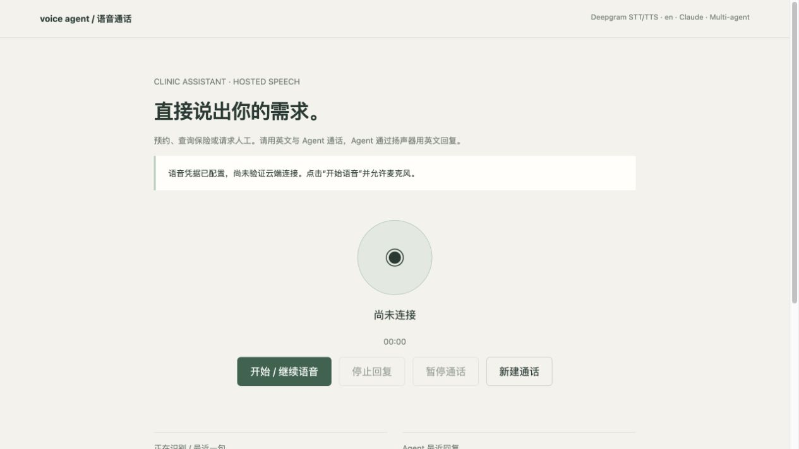
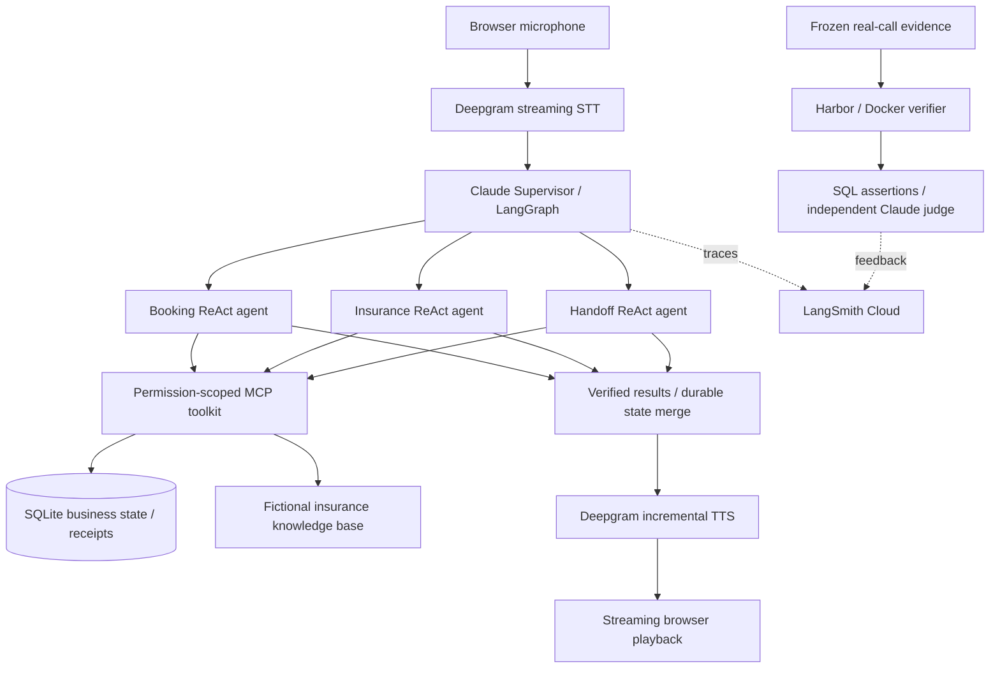

# Multi-Agent Voice Assistant

**A clinic voice assistant with parallel specialists, recoverable execution, and an evaluation harness.**

[](https://github.com/Irenezhangtt/multi-agent-voice-assistant/actions/workflows/ci.yml)


[中文说明](README.zh-CN.md) · [Architecture](docs/multi-agent.md) · [Evaluation results](docs/results/README.md) · [Streaming design](docs/parallel-streaming.md)

An English-speaking, browser-based voice agent that prepares and manages appointments, checks fictional insurance evidence, and records human escalation. Claude handles reasoning, LangGraph coordinates isolated ReAct specialists, MCP exposes business tools, and Deepgram provides streaming speech recognition and synthesis.

The engineering focus is **reliable execution under interruption**: independent tasks run concurrently, verified results can be spoken early, and a superseded task cannot continue writing business state.



*Current local voice interface. The UI is in Chinese; spoken conversations and agent replies are in English. This screenshot shows the idle interface, not an active call.*

## What it does

| Specialist | Capabilities | Completion evidence |
|---|---|---|
| **Booking** | Look up, prepare, create, reschedule, and cancel appointments | SQL rows, revision numbers, and mutation receipts |
| **Insurance** | Retrieve policy/enrollment evidence, assess eligibility, and save citations | Validated evidence references and a versioned assessment |
| **Handoff** | Record an explicit human-escalation request and stop automation | A persisted `human_escalation` marker |

Appointments use normalized phone numbers as customer IDs. Rescheduling preserves the appointment ID; cancellation updates status instead of deleting history. Creating or changing an appointment requires explicit confirmation of a previously displayed offer.

## Architecture



### Parallel delegation with isolated context

- The Supervisor owns conversation history and trusted facts. Specialists receive only their task, latest utterance, pending state, and selected facts.
- Independent booking and insurance delegations execute concurrently against isolated snapshots. Each branch merges only its own domain result.
- Cross-domain fact requests create dependencies; the dispatcher orders prerequisites before dependent tasks and rejects cycles.
- Explicit handoff takes priority over sibling business tasks. Each specialist has its own prompt, tool allowlist, and bounded ReAct loop.

### Durable execution and interruption recovery

- SQLite step journals cache completed model/tool steps for recovery.
- Task revisions fence SQL writes: new speech supersedes unfinished work, and stale tasks cannot commit later effects.
- Idempotency receipts and uniqueness constraints protect against duplicate mutations. Interruption does not undo an operation that already committed.
- An early-streamed appointment offer is persisted before publication, so a caller can confirm it while an unrelated insurance branch is still running.

### Streaming speech with verified output

STT continuously accepts PCM audio and emits interim transcripts; utterance boundaries submit business tasks. TTS accepts verified result text incrementally and returns PCM while later text is still arriving. The first sentence is flushed promptly, with remaining text flushed at completion. Generation checks and cancellation clear superseded audio.

This streams verified business results rather than exposing model reasoning or announcing unverified writes.

## Measured results

Results below come from different test tracks and are intentionally reported separately. **They are not production success rates.** A public, credential-free record is available in [evaluation results](docs/results/README.md) and [summary.json](docs/results/summary.json).

| Track | Result | Scope |
|---|---:|---|
| Current v6 local regression | **89 tests passed** | Includes optional tau2 integration tests |
| Current v6 Harbor regression | **12/12 trials passed** | Scripted model decisions, real MCP/SQL, isolated Docker environments |
| Historical v5 live business cohort | **19/19 outcomes verified** | Custom clinic text scenarios, real Claude/MCP/SQL; includes 5 new-booking requests |
| Historical v5 Sandbox Judge replay | **16 pass / 3 needs review** | Independent Claude prompt/context; mean quality score 92.9/100 |
| Historical v5 Cloud feedback | **152 records read back** | Eight feedback records per evaluated conversation |

### Live API latency comparison

A single same-input comparison used frozen v5 code and v6 code, real Claude/MCP/Deepgram TTS, and separate temporary databases:

| Metric | Sequential v5 | Parallel/streaming v6 |
|---|---:|---:|
| LLM calls | 6 | **4** |
| Server-side text-to-first-audio | 25.02 s | **7.67 s** |
| Complete business result | 24.65 s | **11.22 s** |

The v6 trace confirmed parallel delegation and audio arriving before the entire business turn completed. This is **one live comparison**, not a latency distribution: it excludes STT endpointing, microphone input, client network delay, and playback buffering. The remaining response latency still needs improvement.

## Run locally

**Requirements:** Python 3.12 recommended; Claude and Deepgram API keys for the full voice/multi-agent path. LangSmith and Docker are optional for development, required for their respective cloud-tracing and Sandbox evaluation tracks.

```bash
git clone https://github.com/Irenezhangtt/multi-agent-voice-assistant.git
cd multi-agent-voice-assistant
bash scripts/setup.sh
```

Setup creates `.env` from `.env.example` if it does not exist. Configure your own values locally:

```dotenv
AGENT_MODE=claude
AGENT_ARCHITECTURE=multi-agent
ANTHROPIC_API_KEY=your-anthropic-key
ANTHROPIC_MODEL=claude-sonnet-4-6
DEEPGRAM_API_KEY=your-deepgram-key
DEEPGRAM_STT_MODEL=nova-3
DEEPGRAM_TTS_MODEL=aura-2-thalia-en
SPEECH_LANGUAGE=en
```

If your Claude key requires a workspace header, also set `ANTHROPIC_WORKSPACE_ID`. To enable project-based LangSmith tracing:

```dotenv
LANGSMITH_TRACING=true
LANGSMITH_API_KEY=your-langsmith-key
LANGSMITH_PROJECT=clinic-voice-agent-dev
```

LangSmith Agent addressing is also supported; configure `LANGSMITH_AGENT_ID` and `LANGSMITH_AGENT_ENVIRONMENT` **instead of** `LANGSMITH_PROJECT`. Use the endpoint/region provided by your account.

```bash
.venv/bin/python -m voice_agent doctor
bash scripts/start.sh
```

Open **http://127.0.0.1:8765**, create a call, allow microphone access, and speak English. Use headphones. The [text debugger](http://127.0.0.1:8765/debug) and [API docs](http://127.0.0.1:8765/docs) are also available.

Example requests:

- “Prepare a cleaning appointment for Alex, phone 2025550199, on [a future date] at 2 PM.” Replace the bracketed date with one within the next 90 days.
- After reviewing the offer: “Confirm booking.”
- “Check fictional Aetna insurance for member DEMO123, service cleaning.”
- “I want to speak to a human.”

Without credentials, `AGENT_MODE=mock` supports a limited deterministic text/workflow baseline. It does not exercise the Claude multi-agent path; speech still requires Deepgram credentials.

## Evaluation and reproducibility

### Local regression — no API keys required

```bash
LANGSMITH_TRACING=false .venv/bin/python -m pytest -q
node tests/check_audio_worklet.cjs
```

The base runtime/CI suite skips tau2-specific integration tests when the optional benchmark environment is absent. The 89-test local result includes that environment.

### Harbor Docker business regression — offline model boundary

Install and start Docker, then:

```bash
python3.12 -m venv .harbor-venv
.harbor-venv/bin/python -m pip install -r requirements-harbor.lock
HARBOR_DATASET=evals/multi-agent-dataset.json \
HARBOR_EXPORT_DIR=reports/harbor/my-regression \
bash scripts/harbor-eval.sh run
```

This runs four scenarios with three attempts each. Model decisions are scripted; MCP calls and SQL operations are real. Runtime networking is disabled. See [Harbor regression](docs/harbor-evals.md).

### Live conversations and Sandbox LLM judging — uses paid APIs

```bash
# Install the pinned official tau2 runtime in a separate environment.
bash scripts/tau-eval.sh setup

# Eight project-authored clinic cases, two trials each.
bash scripts/tau-eval.sh run --trials 2 --output reports/tau/my-live-run

# Judge those conversations and generate three additional live scenarios.
bash scripts/judge-eval.sh run \
  --source reports/tau/my-live-run \
  --output reports/judge/my-judge-run

# Re-evaluate the saved real conversations inside Harbor Docker verifiers.
bash scripts/harbor-judge.sh prepare \
  --source reports/judge/my-judge-run/summary.json \
  --output reports/harbor/my-judge-replay
bash scripts/harbor-judge.sh run --output reports/harbor/my-judge-replay
.venv/bin/python -m evals.harbor_judge_report --export reports/harbor/my-judge-replay
```

The official tau2 simulator drives a **custom clinic domain**, not the official airline/retail task set or leaderboard. The standalone judge command runs on the host; the Harbor replay command runs judging in Docker verifiers. Replay does not create new business conversations. Judge results supplement independent SQL checks; they cannot override a failed SQL gate.

Exports freeze code, prompts, inputs, and dependency references. Sandbox Judge credentials are injected at verifier runtime rather than copied into images. API outputs remain nondeterministic; repeated grading showed score variation. See [tau2 integration](docs/tau-bench.md) and [Sandbox Judge](docs/harbor-judge.md).

### Repeat the live latency probe

```bash
.venv/bin/python evals/latency_probe.py --output reports/latency/my-probe.json
```

This uses temporary business state and paid Claude/Deepgram APIs. A fresh output path is required; it does not open the microphone or play audio automatically.

## Repository map

```text
voice_agent/
  multi_agent.py       Supervisor, isolated ReAct graphs, dependency-aware dispatch
  execution.py         Durable steps, task revisions, interruption checks
  runtime.py           Runtime assembly and turn execution
  mcp_client.py        Official MCP stdio session and tool discovery
  mcp_server.py        Permission-scoped business tools
  appointments.py      Appointment transactions and mutation receipts
  insurance_rag.py     Structured evidence retrieval and assessment validation
  voice.py             Duplex voice coordination and early result publication
  speech.py            Deepgram streaming STT/TTS adapter
  prompts/             Role-specific system prompts
  static/              Browser microphone UI and text debugger
evals/                 SQL graders, tau2 adapters, Judge and Harbor harnesses
tests/                 Business, concurrency, recovery, speech and evaluator tests
scripts/               Setup, service and evaluation entry points
docs/                  Architecture, operation, evaluation and public results
```

Local databases, `.env` files, recordings, raw reports, virtual environments, and the downloaded upstream benchmark checkout are excluded from Git. Published results contain aggregate metrics and selected code hashes, not caller transcripts or private Cloud run links.

## MVP boundaries

- Browser voice entry only; no PSTN integration or actual telephone transfer.
- Insurance documents and enrollment records are explicitly fictional demo data.
- Human escalation currently records a marker; it does not connect a person or schedule a callback.
- Phone numbers identify demo customer records and do not authenticate callers.
- Single-process local FastAPI/SQLite deployment; no production authentication or multi-tenant service.
- No measured real-caller hangup rate or average telephone duration; simulated `USER_STOP` is not a hangup.

Use synthetic information. Audio is sent to Deepgram; necessary text/context is sent to Anthropic, and enabling LangSmith sends selected trace/evaluation data to that service.
