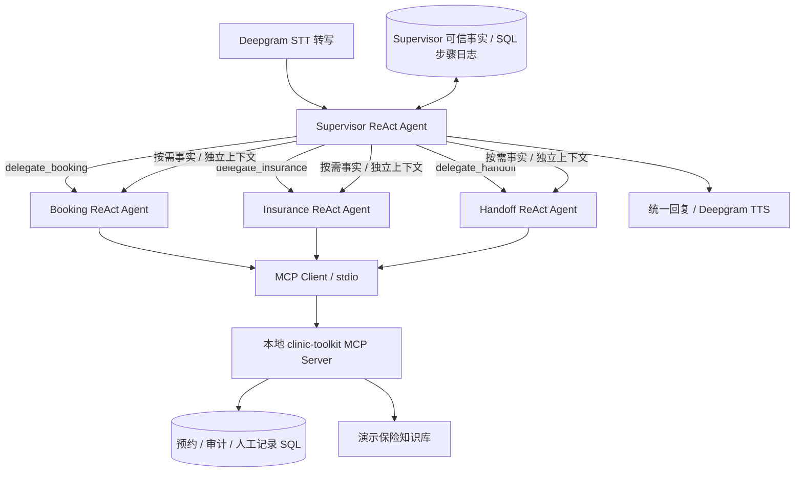

# Supervisor + ReAct Agents + MCP Toolkit

默认 `AGENT_MODE=claude`、`AGENT_ARCHITECTURE=multi-agent`。这是由主 Agent 决定如何委派、专职 Agent 决定调用哪些 MCP 工具的系统。旧 workflow 仅保留为显式的基线模式和离线规则回归，不会在多 Agent 出错时自动替代。



## 决策层

- Supervisor 有自己的 system prompt、model/tool 循环和 `delegate_*` 工具。它可以先调用保险，再调用预约，也可以只调用某一个；不是一个返回分类标签后结束的路由器。
- 每个子 Agent 有独立的 system prompt、model/tool 循环及白名单。ReAct 的实现是 LangGraph 的 `model → tools → model`，模型自主选择下一步工具并读取 observation。不是把原有 workflow 改名成 Agent。
- 初版均采用 ReAct；没有声称已实现 Plan-and-Execute。对话缺失信息需要等待客户下一轮，不适合先生成长计划再执行全部步骤。未来可以单独替换某个子 Agent 的执行图。
- 主 Agent 与子 Agent 共用同一 Claude 模型服务，但分别构造工具绑定和上下文窗口。多 Agent 不要求多个模型供应商或多个操作系统进程。
- v6 支持 Supervisor 在同一模型响应中规划独立的 Booking／Insurance 委派，并在两个线程中实际并行执行。各分支使用隔离快照和独立步骤 key，合并时仅更新自己的领域；完整并行批次结束后不再额外调用 Supervisor 生成总结。跨域 fact_keys 表达依赖，同批次按依赖排序；循环依赖拒绝执行。人工升级优先且不与业务操作并行。
- 默认每个 Agent 最多 5 个模型回合，每个专职 Agent 每轮最多委派一次。达到上限会停止，不会无限重试。详见 [并行与流式链路](parallel-streaming.md)。

## 上下文

Supervisor 持有电话 history、规范业务状态和所有可信事实。子 Agent 消息上下文隔离：每次只传入最新原话、简短任务、自己的 pending_task 和按角色选择的 trusted_facts；不传完整 history、其他 Agent 消息或原始检索文档。Supervisor 可通过 delegate 工具的 fact_keys 按需提供跨领域事实，子 Agent 仅回传精简 summary、status 和 fact_delta。

执行通过 SQL 步骤日志恢复，新最终转写会替换旧的未完成任务。语音断线暂停后可在同一 call_id 重连恢复；SQL 提交有任务版本检查及幂等回执。完整机制、API 和边界见 [可恢复执行说明](durable-execution.md)。

## 提示词与执行代码

| 角色 | 独立提示词 | 工具权限 |
|---|---|---|
| Supervisor | `voice_agent/prompts/supervisor.md` | 三个 `delegate_*` 工具 |
| Booking | `voice_agent/prompts/booking.md` | `find_booking`、`search_availability`、`prepare_appointment`、`commit_appointment`、`reconcile_appointment` |
| Insurance | `voice_agent/prompts/insurance.md` | `retrieve_insurance_evidence`、`record_insurance_assessment` |
| Handoff | `voice_agent/prompts/handoff.md` | `mark_human_escalation` |

`voice_agent/multi_agent.py` 定义各个 ReAct 图和委派机制；`voice_agent/mcp_policy.py` 定义白名单；`voice_agent/mcp_client.py` 管理 MCP 会话；`voice_agent/mcp_server.py` 发布工具。

## 真正的 MCP 链路

启动应用时自动通过当前 Python 解释器启动一个本地 `voice_agent.mcp_server` 子进程。官方 MCP SDK 通过 stdio 完成初始化、`tools/list` 发现和 `tools/call` 调用。主机将发现的 JSON Schema 转换为 LangChain StructuredTool 供模型选择；不是直接把 Python 函数假称为 MCP。

MCP Server 无需额外公网端口，也不依赖 Docker。子进程不会加载 `.env`，主机只传递允许的运行环境，不转发 Claude、Deepgram 或 LangSmith Key。保险判断由 Insurance Agent 的模型完成，MCP 工具只检索证据和验证、保存它的判断；没有隐藏的第二个保险 LLM 调用。

`GET /api/agents` 可查看实际模式、Agent 名称、工具权限和 MCP 连接状态。`GET /health` 返回当前 architecture。

## 自主选择与写入规则

自主的是“调用哪个子 Agent、哪个工具、什么时候再次读取结果”。SQL 写入的授权仍由代码判定：

1. `prepare_appointment` 接收有限字段和 action，调用预约服务校验，返回完整 review summary。此工具不写预约；修改和取消也先准备方案。
2. 工具结果中的规范摘要必须给客户，主机据此形成回复和持久化状态。模型不能伪造“已成功”的业务确认。
3. 下一轮客户明确确认后，Agent 才能选择 `commit_appointment`。该工具没有可改写的预约字段；服务端加载上一轮持久化方案并检查实际客户原话。最近一条助手回复必须包含该方案的规范摘要；客户对其他问题说“是的”不能授权旧方案。
4. 同轮准备又提交、Agent 自己声称获得确认、伪造 call_id/scope，都会被拒绝。
5. SQL 事务、客户与时段唯一索引、revision 和操作回执继续防止重复和覆盖冲突。进程在写入后中断时，可用原回执核验。
6. 保险必须先检索相同客户查询，再提交引用和知识库 hash；未检索、引用伪造或证据不支持时不能判定有效。
7. 人工标记成功后，本通电话停止其他自动业务工具。

MCP 的 call scope 由可信本地主机注入，对模型隐藏；权限同时在主机和服务端检查。这是本地开发边界，不是提供给不可信远程客户端的认证方案。

## Trace 与验证

LangSmith 在同一 `call_turn` 下记录 Supervisor 图、delegate 工具、子 Agent 图、模型和主机 MCP 工具 span。共享 call_id/版本可用于关联；MCP Server 的内部 SQL 服务步骤不单独向云端发送凭据或 trace。

- `tests/test_multi_agent.py`：脚本模型决策 + 实际 stdio MCP + 真实临时 SQL，检查上下文隔离及按需事实、角色权限、确认、幂等和循环上限。
- `evals/multi-agent-dataset.json`：四类专用场景；模型决策为脚本替身，工具和 SQL 为真实执行，不衡量模型推理准确率。
- `evals/dataset.json`：原 24 个固定 workflow 基线场景，不能把它的通过率当作多 Agent 的模型质量。
- 真实 Claude 测试仅用虚构信息、临时数据库，报告在 `reports/multi-agent-live.json` 与 `reports/multi-agent-compound-live.json`。

专用 Harbor 命令：

```bash
HARBOR_DATASET=evals/multi-agent-dataset.json \
HARBOR_EXPORT_DIR=reports/harbor/durable-isolated-v5-final \
bash scripts/harbor-eval.sh run
```

默认 4 个案例 × 3 次重复 = 12 个容器 trials，运行时断网。冻结代码、提示词、知识库和依赖锁，不带业务库或 API Key。
